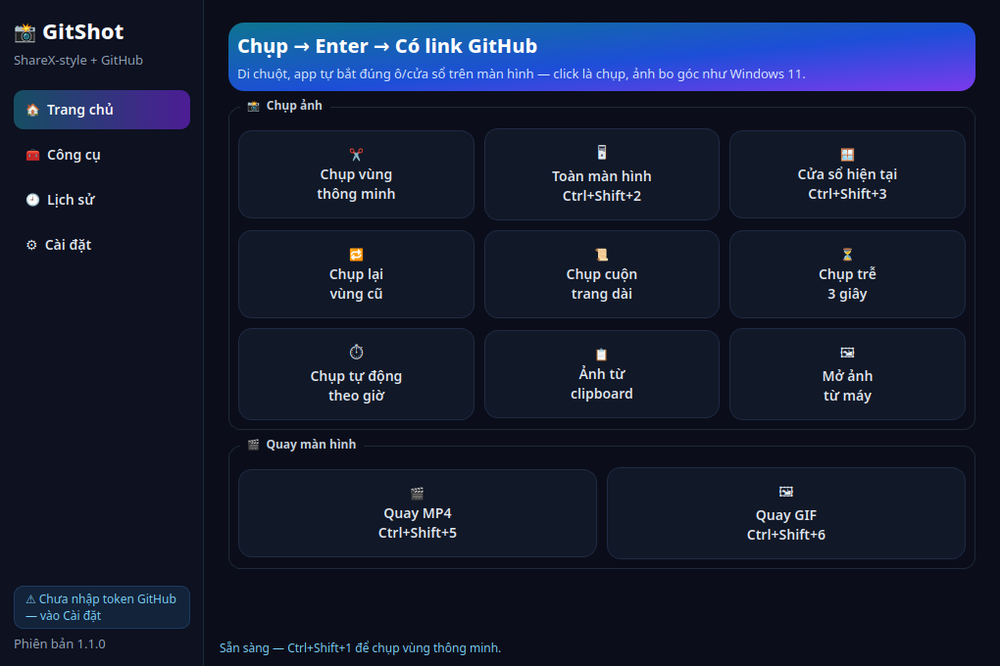
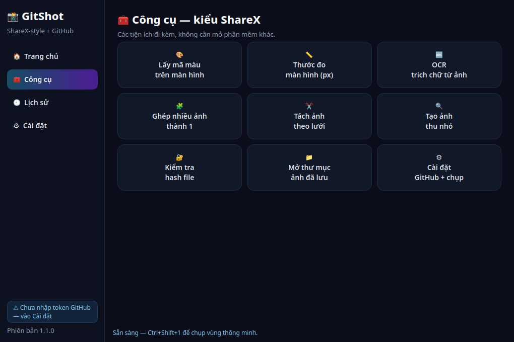
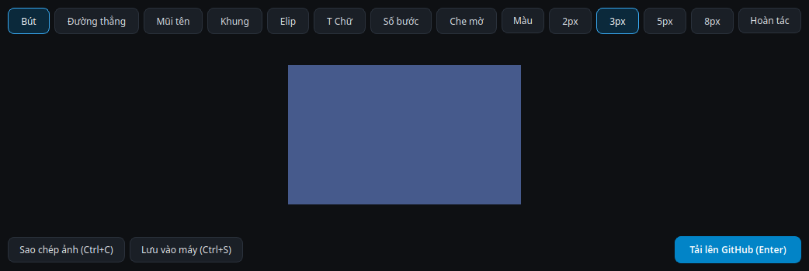

# 📸 GitShot — Chụp màn hình, Enter là lên GitHub

Phần mềm chụp/quay màn hình cho Windows với đầy đủ chức năng kiểu **ShareX**, cộng thêm tính năng mà ShareX không có:

> **Chụp xong → ấn `Enter` (hoặc nút "Gửi lên GitHub") → ảnh được push thẳng lên GitHub → link ảnh tự copy vào clipboard.**


| Màn hình chính | Trang Công cụ | Trình sửa ảnh |
|---|---|---|
|  |  |  |

## 🆕 Mới ở v1.1

- **Chụp vùng THÔNG MINH**: di chuột tới đâu, app tự nhận diện "ô vuông có sẵn" ở đó (cửa sổ, khung, nút, ô nhập…) và tô sáng bo góc theo đúng ô — **click 1 cái là chụp đúng ô đó**, ảnh được **bo góc tròn** như cửa sổ Windows 11. Kéo tay thì 4 cạnh tự **hít** vào cạnh ô gần nhất. Phím `S` bật/tắt chế độ nhận ô.
- **Giao diện mới**: thanh điều hướng bên trái (Trang chủ / Công cụ / Lịch sử / Cài đặt), banner gradient, thẻ chức năng theo nhóm, chip trạng thái GitHub, **lịch sử dạng lưới thumbnail**.
- **Thêm cách chụp**: chụp lại vùng cũ, chụp trễ 3 giây, **chụp tự động theo giờ** (tự upload), ảnh từ clipboard, mở ảnh từ máy để sửa/upload.
- **Trang Công cụ kiểu ShareX**: lấy mã màu trên màn hình (click là copy HEX), thước đo px, OCR trích chữ từ ảnh, ghép nhiều ảnh thành 1, tách ảnh theo lưới, tạo ảnh thu nhỏ, kiểm tra hash file (MD5/SHA256), mở thư mục ảnh.

## ⬇ Tải về

Vào mục **[Releases](../../releases)** tải `GitShot.exe` — chạy luôn, không cần cài đặt.
Mỗi lần đẩy tag mới, GitHub Actions tự build bản `.exe` mới tại đây.

## 🚀 Dùng trong 3 phút

### 1. Tạo GitHub Token (làm 1 lần duy nhất)

1. Vào **github.com → ảnh avatar → Settings → Developer settings → Personal access tokens → Fine-grained tokens → Generate new token**
2. Đặt tên token (ví dụ `GitShot`), chọn hạn dùng
3. **Repository access**: chọn *Only select repositories* → chọn repo chứa ảnh (mặc định `gitshot-uploads` — app tự tạo nếu chưa có)
4. **Permissions → Repository permissions → Contents: Read and write**
5. Generate → copy token

> Cách nhanh hơn: token dạng *Classic* với quyền `repo` cũng dùng được.

### 2. Dán token vào app

Mở GitShot → **⚙ Cài đặt GitHub** → dán token → **Kiểm tra kết nối** → **Lưu cài đặt**.

### 3. Chụp và gửi

| Thao tác | Phím tắt |
|---|---|
| Chụp vùng chọn | `Ctrl+Shift+1` |
| Chụp toàn màn hình | `Ctrl+Shift+2` |
| Chụp cửa sổ đang dùng | `Ctrl+Shift+3` |
| Chụp cuộn trang dài | `Ctrl+Shift+4` |
| Quay màn hình MP4 | `Ctrl+Shift+5` |
| Quay GIF | `Ctrl+Shift+6` |
| **Gửi lên GitHub** | **`Enter`** (trong cửa sổ sửa ảnh) |

Sau khi upload, anh nhận được link dạng:

```
https://raw.githubusercontent.com/<user>/gitshot-uploads/main/uploads/2026/11/shot_2026-11-05_14-30-05.png
```

Link này dán vào Facebook, Zalo, Markdown, tài liệu… đều hiển thị ảnh ngay. Trong Cài đặt có thể đổi sang link CDN (jsDelivr — tải nhanh hơn) và định dạng copy: link thuần / Markdown `` / HTML ``.

## ✨ Chức năng

- **Chụp**: vùng chọn thông minh tự bắt ô/cửa sổ + bo góc tròn, toàn màn hình (đa màn hình), cửa sổ active, **chụp cuộn** tự ghép ảnh dài, chụp lại vùng cũ, chụp trễ, chụp tự động theo giờ
- **Sửa ngay sau khi chụp**: bút, đường thẳng, mũi tên, khung, elip, chữ, **đánh số bước ①②③**, **che mờ** vùng nhạy cảm, đổi màu/độ dày, hoàn tác
- **Quay**: MP4 và GIF theo vùng chọn hoặc toàn màn hình
- **GitHub**: tự tạo repo chứa ảnh nếu chưa có, upload qua API chính thức, tự xử lý khi trùng tên file, thông báo lỗi tiếng Việt dễ hiểu (token sai, thiếu quyền…)
- **Lịch sử**: mọi ảnh đã chụp/đã upload, nhấp đúp để copy lại link
- **Chạy nền ở khay hệ thống**, phím tắt toàn cục hoạt động kể cả khi cửa sổ chính đã đóng
- Tự lưu bản sao trong máy tại `Pictures/GitShot`

## ⚠ Lưu ý

- Repo chứa ảnh nên để **Public** thì người khác mới mở được link. Nếu để Private, link raw sẽ cần token mới xem được.
- Token chỉ lưu trên máy của anh tại `%APPDATA%/GitShot/config.json` — không nằm trong code, không gửi đi nơi nào khác ngoài `api.github.com`.
- GitHub giới hạn 100MB/file qua API — dư sức cho ảnh chụp và video quay ngắn.

## 🛠 Chạy từ mã nguồn

```bash
pip install -r requirements.txt
python run.py
# Kiểm thử logic: python -m unittest discover -s tests -v
# Đóng gói: pyinstaller GitShot.spec
```

## Giấy phép

MIT
