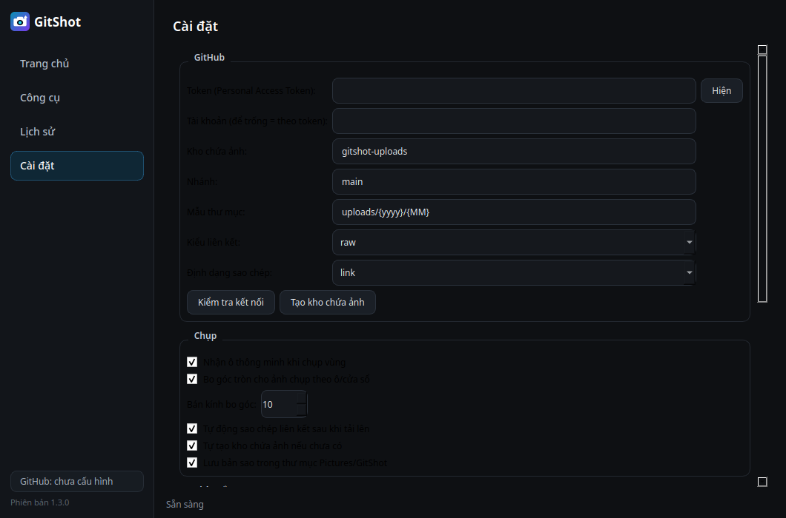

# GitShot

Ứng dụng chụp và quay màn hình cho Windows. Ảnh chụp được tải trực tiếp lên GitHub và trả về liên kết để chia sẻ.


| Trang chủ | Công cụ | Trình sửa ảnh | Cài đặt |
|---|---|---|---|
|  |  |  |  |

## Tải về

Tải `GitShot.exe` tại mục [Releases](../../releases). Tệp chạy trực tiếp, không cần cài đặt.

## Cài đặt lần đầu

Ứng dụng cần một GitHub Personal Access Token để tải ảnh lên. Token chỉ cấu hình một lần.

1. Mở github.com → Settings → Developer settings → Personal access tokens → Fine-grained tokens → Generate new token.
2. Tại Repository access, chọn kho `gitshot-uploads` (ứng dụng tự tạo nếu chưa có).
3. Tại Permissions → Repository permissions, đặt Contents = Read and write.
4. Tạo token, sao chép giá trị.
5. Mở GitShot → Cài đặt → dán token → Kiểm tra kết nối → Lưu cài đặt.

Token dạng Classic với quyền `repo` cũng được chấp nhận.

## Sử dụng

| Thao tác | Phím tắt mặc định |
|---|---|
| Chụp vùng | Ctrl+Shift+1 |
| Toàn màn hình | Ctrl+Shift+2 |
| Cửa sổ hiện tại | Ctrl+Shift+3 |
| Chụp cuộn | Ctrl+Shift+4 |
| Quay MP4 | Ctrl+Shift+5 |
| Quay GIF | Ctrl+Shift+6 |
| Chụp lại vùng cũ | Ctrl+Shift+7 |
| Lấy mã màu | Ctrl+Shift+8 |
| Tải ảnh lên GitHub | Enter (trong cửa sổ sửa ảnh) |

Toàn bộ phím tắt có thể thay đổi tại Cài đặt → Phím tắt.

Sau khi tải lên, liên kết có dạng:

```
https://raw.githubusercontent.com/<user>/gitshot-uploads/main/uploads/2026/11/shot_2026-11-05_14-30-05.png
```

Liên kết được tự động sao chép vào clipboard. Kiểu liên kết (raw hoặc CDN) và định dạng sao chép (liên kết, Markdown, HTML) cấu hình tại Cài đặt.

## Tính năng

- Chụp vùng thông minh: tự nhận ô/cửa sổ tại vị trí con trỏ, nhấp để chụp đúng ô, cạnh tự hít khi kéo chọn, ảnh bo góc tròn theo cửa sổ. Khớp tọa độ theo DPI từng màn hình (scaling 125–150%).
- Chụp toàn màn hình (đa màn hình), cửa sổ hiện tại, chụp cuộn tự ghép, chụp lại vùng cũ, chụp trễ, chụp tự động theo chu kỳ kèm tự động tải lên.
- Quay màn hình MP4 và GIF theo vùng hoặc toàn màn hình — ghi thẳng xuống đĩa theo luồng, quay dài không ngốn RAM.
- Trình sửa ảnh tích hợp: bút, đường thẳng, mũi tên, khung, elip, chữ, đánh số bước, che mờ, hoàn tác.
- Định dạng ảnh PNG/JPG/WebP; chế độ chụp xong tải lên ngay không mở trình sửa.
- Kéo-thả file ảnh vào cửa sổ để mở sửa/tải lên; menu chuột phải trong Lịch sử (mở tệp, mở thư mục, xóa mục).
- Công cụ: lấy mã màu, thước đo, OCR (cần Tesseract cài riêng), ghép ảnh, tách ảnh theo lưới, tạo ảnh thu nhỏ, kiểm tra hash MD5/SHA256.
- Lịch sử dạng lưới, nhấp đúp để sao chép lại liên kết.
- Chạy nền tại khay hệ thống; phím tắt toàn cục tự cấu hình; một tiến trình duy nhất; tự báo khi có bản mới.
- Bản sao cục bộ tại thư mục Pictures/GitShot.

## Lưu ý kỹ thuật

- Kho chứa ảnh cần ở chế độ Public để liên kết mở được không cần đăng nhập.
- Token chỉ lưu tại `%APPDATA%/GitShot/config.json` trên máy người dùng.
- Giới hạn tải lên của GitHub API là 100 MB mỗi tệp.
- Nhật ký lỗi ghi tại `%APPDATA%/GitShot/gitshot.log` — gửi kèm file này khi báo lỗi.
- OCR cần Tesseract cài riêng trên máy (bản .exe chưa đóng gói kèm).

## Phát triển

```bash
pip install -r requirements.txt
python run.py
python -m unittest discover -s tests -v   # kiểm thử
pyinstaller GitShot.spec                  # đóng gói .exe
```

## Giấy phép

MIT
